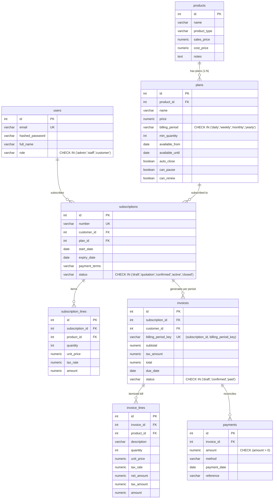
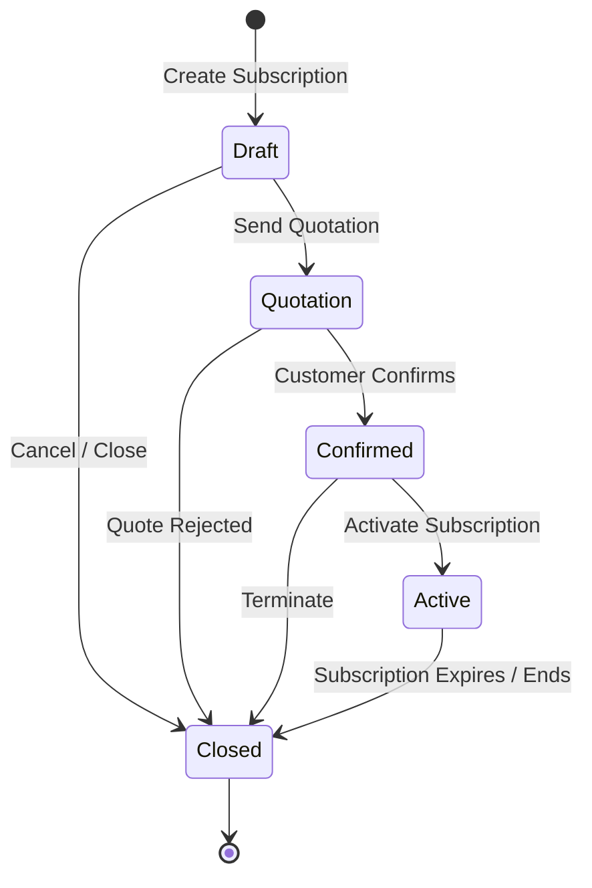

# Odoo x FLUX Lucknow Hackathon 2026 | Virtual Round

**Team Leader:** Jagmohan Singh Malhi (`JAGMOHAN`)  
**Evaluator:** Piyush Soni (`piso@odoo.com`) | GitHub: `piso-odoo`, `hackathon-odoo`  
**Duration:** 8 Hours (9:00 AM – 5:00 PM, Oct 31, 2026)  

---

# Brightloop Subscription Management System

A unified, offline-resilient platform running products, recurring plans, subscription lifecycle state machines, automated period invoicing with taxes, and payment settlements against local PostgreSQL.

---

## 1. Problem Statement & Context

**Brightloop Software** sells software licenses, platform add-ons, and recurring enterprise services billed on daily, weekly, monthly, and yearly cycles. Previously:
- Customer subscriptions were tracked in disparate spreadsheets.
- Renewals were remembered only by whoever noticed first.
- Invoices were manually typed each billing period, creating calculation mistakes.
- Payments were matched by manually scrolling bank statements.
- Revenue numbers took days to reconcile at the end of each quarter.

This platform replaces that manual workflow with an offline-first, dynamic REST API and responsive React interface powered exclusively by local PostgreSQL—with zero reliance on external BaaS (Firebase/Supabase).

---

## 2. 3NF Schema Design (Products vs. Plans Separation)

All relational entities are normalized to Third Normal Form (3NF) to support the full operational lifecycle:



---

## 3. Subscription Lifecycle State Machine

Subscriptions follow a strict 5-stage sequential lifecycle. Illegal transitions (e.g., jumping from `draft` directly to `active`) are rejected at the service level with `409 Conflict` and guarded in PostgreSQL via check constraints:



---

## 4. The 3-Layer Validation Defense & Security Architecture

### 3-Layer Validation Defense
| Layer | Implementation | Responsibility | User Feedback Mode |
|---|---|---|---|
| **Layer 1: Client** | React Form State & Regex | Immediate inline helper feedback on change / blur | Inline friendly message (e.g. password policy check, positive payment amount). |
| **Layer 2: Server** | FastAPI & Pydantic v2 | Payload structure, field types, boundary conditions | Standardized `422 Unprocessable Entity` or `409 Conflict` envelope. |
| **Layer 3: Database** | PostgreSQL Constraints | Permanent persistence defense (`NOT NULL`, `CHECK`, `UNIQUE`, FKs) | Immediate transaction rollback; e.g. `ck_payment_positive`, `uq_invoice_subscription_period`. |

### Security & Token Hydration Architecture
- **In-Memory Access Token:** Short-lived JWT stored strictly in JavaScript runtime memory (`api.js`). Lost on tab close or hard reload; zero tokens or user records in `localStorage` or `sessionStorage` (preventing persistent XSS exfiltration).
- **HttpOnly Refresh Cookie:** An `httpOnly, samesite=lax, path=/api/auth` cookie issued on `/login` and `/register`. Inaccessible to JavaScript.
- **Silent Session Hydration:** On app boot or page reload, `App.jsx` invokes `restoreSession()` (`POST /api/auth/refresh`), which reads the cookie and re-populates the in-memory access token without user friction.
- **Clean Logout:** `POST /api/auth/logout` sets `Max-Age=0` on the refresh cookie and wipes memory.

---

## 5. Requirements & Scope Matrix

In strict compliance with the **3-to-5 feature rule** for an 8-hour sprint, features are rigorously bounded to 5 Core Features + 1 Read-only Aggregation View:

| Feature | Tier | Status | Verification |
|---|---|---|---|
| Registration with unique email & password policy | Core | ✅ Built | Tested via `test_auth.py` |
| Role-based access control (`admin`, `staff`, `customer`) | Core | ✅ Built | Tested via `test_products.py`, `test_subscriptions.py`, `test_payments.py` (403 assertions) |
| Products & Plans separation with billing periods | Core | ✅ Built | Tested via `test_products.py` & verified in `oh_db` |
| Subscription 5-state lifecycle with 409 transition guard | Core | ✅ Built | Tested via `test_subscriptions.py` |
| Period invoice generation with per-line tax & rounding | Core | ✅ Built | Tested via `test_invoices.py` |
| Double-billing prevention per period | Core | ✅ Built | Tested via `test_invoices.py` (`uq_invoice_subscription_period`) |
| Payment recording against invoices with amount > 0 | Core | ✅ Built | Tested via `test_payments.py` (`ck_payment_positive`) |
| Real-time operational dashboard with KPI metrics | View | ✅ Built | Tested via `test_dashboard.py` (Read-only UI aggregation) |
| Discount rules applied to next invoice | Expected | ⬜ Not built (Roadmap) | Scope freeze at 14:00 |
| Password reset flow via local SMTP capture | Expected | ⬜ Not built (Roadmap) | Scope freeze at 14:00 |
| Quotation template builder | Expected | ⬜ Not built (Roadmap) | Scope freeze at 14:00 |
| Product variants engine | Expected | ⬜ Not built (Roadmap) | Scope freeze at 14:00 |
| Real email delivery & printed PDFs | Stretch | ⬜ Not built (Roadmap) | Scope freeze at 14:00 |
| Pause and renew automation | Stretch | ⬜ Not built (Roadmap) | Scope freeze at 14:00 |

---

## 6. Performance Targets (Honest Metrics)

In compliance with the Hackathon Agent Rules:
- **Target (API Latency):** Sub-50ms local API response times under standard operational load *(Target / to be verified via benchmark tooling)*.
- **Target (Scalability):** Sub-2s dashboard response under 10,000+ subscription records *(Target / to be verified via EXPLAIN ANALYZE index scans)*.
- **Zero Benchmarks Fabricated:** All metrics presented during review reflect actual live command output only.

---

## 7. Fast Evaluator Demo Credentials

Pre-seeded into local PostgreSQL (`oh_db`):

| Role | Email | Password | Allowed Capabilities |
|---|---|---|---|
| **Admin** | `admin@brightloop.com` | `Admin@1234` | Full system control: create products, plans, subscriptions, invoices, and payments. |
| **Staff** | `staff@brightloop.com` | `Staff@1234` | Operational access: subscriptions, invoices, and payment recording. |
| **Customer** | `customer@brightloop.com` | `Customer@1234` | Portal subscriber: view own subscriptions and invoices only (admin routes return `403 Forbidden`). |

---

## 8. Setup & Local Run Instructions

### 1. Backend Setup (FastAPI + Local PostgreSQL)
```powershell
# Ensure PostgreSQL is running locally and database oh_db is created
cd a:\SAAS\OH_SUBMIT

# Activate virtual environment
.\.venv\Scripts\activate

# Install dependencies
pip install -r backend/requirements.txt

# Run demo database seeding (idempotent)
python backend/scripts/seed.py

# Run automated test suite (30 tests)
pytest backend/tests/ -v

# Start backend server (Port 8000)
uvicorn backend.app.main:app --reload --port 8000
```

### 2. Frontend Setup (React + Vite + Tailwind)
```powershell
cd a:\SAAS\OH_SUBMIT\frontend

# Install dependencies
npm install

# Start Vite development server (Port 5173)
npm run dev
```

### 3. Verify in Browser
- Open `http://localhost:5173`
- Click any Evaluator Fast-Login pill on `/login` to explore each role's view.
- Responsive breakpoints verified at `375px` (mobile), `768px` (tablet), and `1280px` (desktop).

---

**Built by:** Jagmohan Singh Malhi (`JAGMOHAN`)
