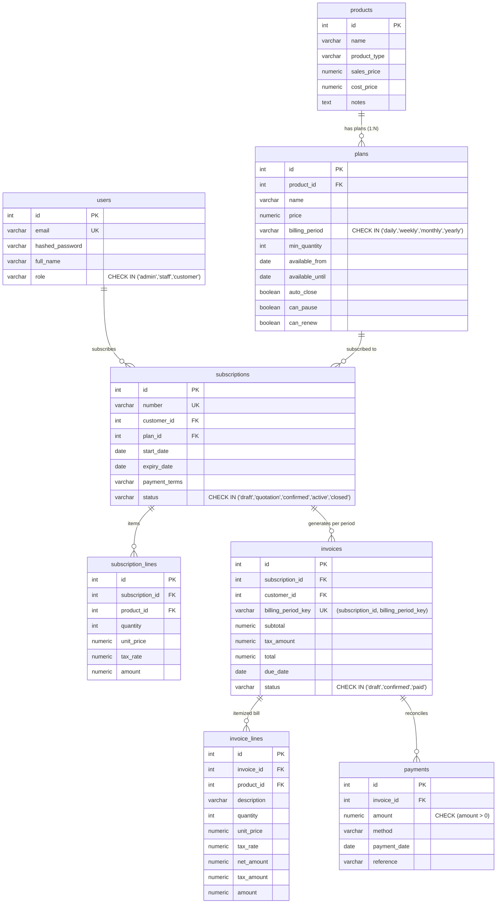
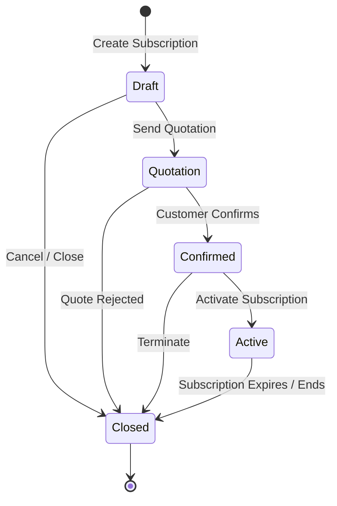

# Odoo x FLUX Lucknow Hackathon 2026 | Virtual Round

**Team Leader:** Jagmohan Singh Malhi (`JAGMOHAN`)  
**Evaluator:** Piyush Soni (`piso@odoo.com`) | GitHub: `piso-odoo`, `hackathon-odoo`  
**Duration:** 8 Hours (9:00 AM – 5:00 PM, Oct 31, 2026)  

---

# Brightloop Subscription Management System

A unified, offline-resilient platform running products, recurring plans, subscription lifecycle state machines, automated period invoicing with taxes, and payment settlements against local PostgreSQL.

---

## 1. Problem Statement & Context

**Brightloop Software** sells software licenses, platform add-ons, and recurring enterprise services billed on daily, weekly, monthly, and yearly cycles. Previously:
- Customer subscriptions were tracked in disparate spreadsheets.
- Renewals were remembered only by whoever noticed first.
- Invoices were manually typed each billing period, creating calculation mistakes.
- Payments were matched by manually scrolling bank statements.
- Revenue numbers took days to reconcile at the end of each quarter.

This platform replaces that manual workflow with an offline-first, dynamic REST API and responsive React interface powered exclusively by local PostgreSQL—with zero reliance on external BaaS (Firebase/Supabase).

---

## 2. 3NF Schema Design (Products vs. Plans Separation)

All relational entities are normalized to Third Normal Form (3NF) to support the full operational lifecycle:



---

## 3. Subscription Lifecycle State Machine

Subscriptions follow a strict 5-stage sequential lifecycle. Illegal transitions (e.g., jumping from `draft` directly to `active`) are rejected at the service level with `409 Conflict` and guarded in PostgreSQL via check constraints:



---

## 4. The 3-Layer Validation Defense & Security Architecture

### 3-Layer Validation Defense
| Layer | Implementation | Responsibility | User Feedback Mode |
|---|---|---|---|
| **Layer 1: Client** | React Form State & Regex | Immediate inline helper feedback on change / blur | Inline friendly message (e.g. password policy check, positive payment amount). |
| **Layer 2: Server** | FastAPI & Pydantic v2 | Payload structure, field types, boundary conditions | Standardized `422 Unprocessable Entity` or `409 Conflict` envelope. |
| **Layer 3: Database** | PostgreSQL Constraints | Permanent persistence defense (`NOT NULL`, `CHECK`, `UNIQUE`, FKs) | Immediate transaction rollback; e.g. `ck_payment_positive`, `uq_invoice_subscription_period`. |

### Security & Token Hydration Architecture
- **In-Memory Access Token:** Short-lived JWT stored strictly in JavaScript runtime memory (`api.js`). Lost on tab close or hard reload; zero tokens or user records in `localStorage` or `sessionStorage` (preventing persistent XSS exfiltration).
- **HttpOnly Refresh Cookie:** An `httpOnly, samesite=lax, path=/api/auth` cookie issued on `/login` and `/register`. Inaccessible to JavaScript.
- **Silent Session Hydration:** On app boot or page reload, `App.jsx` invokes `restoreSession()` (`POST /api/auth/refresh`), which reads the cookie and re-populates the in-memory access token without user friction.
- **Clean Logout:** `POST /api/auth/logout` sets `Max-Age=0` on the refresh cookie and wipes memory.

---

## 5. Requirements & Scope Matrix

In strict compliance with the **3-to-5 feature rule** for an 8-hour sprint, features are rigorously bounded to 5 Core Features + 1 Read-only Aggregation View:

### Core Vertical Slice (Built & Verified — 5 Features + 1 View)
| Feature | Tier | Status | Verification |
|---|---|---|---|
| Registration with unique email & password policy (8+ chars, upper, lower, special) | Core | ✅ Built | Tested via `test_auth.py` |
| Role-based access control (`admin`, `staff`, `customer`) | Core | ✅ Built | Tested via `test_products.py`, `test_subscriptions.py`, `test_payments.py` (403 assertions) |
| Products & Plans separation with billing periods (`daily`, `weekly`, `monthly`, `yearly`) | Core | ✅ Built | Tested via `test_products.py` & verified in `oh_db` |
| Subscription 5-state lifecycle (`draft` → `quotation` → `confirmed` → `active` → `closed`) with 409 transition guard | Core | ✅ Built | Tested via `test_subscriptions.py` |
| Period invoice generation with per-line tax & half-up rounding | Core | ✅ Built | Tested via `test_invoices.py` |
| Double-billing prevention per period (`uq_invoice_subscription_period`) | Core | ✅ Built | Tested via `test_invoices.py` |
| Payment recording against invoices with `ck_payment_positive` (`amount > 0`) | Core | ✅ Built | Tested via `test_payments.py` |
| Real-time operational dashboard with KPI metrics (Read-only UI aggregation) | View | ✅ Built | Tested via `test_dashboard.py` (No state mutations) |

### Expected & Stretch Features (Incrementally Built & Tested)
| Requirement | Tier | Status | Specification & Verification |
|---|---|---|---|
| Discount rules applied to next invoice | Expected | ✅ Built | Tested via `test_discounts.py`: Admin CRUD, concurrency `SELECT ... FOR UPDATE`, invoice line-item storage, expired 400, limit 409, percent > 100 422. |
| Password reset flow | Expected | ✅ Built | Tested via `test_password_reset.py`: Anti-enumeration 200, SHA-256 single-use tokens, 30-min expiry 400, reused 400, password policy 422, `token_version` session revocation 401, offline capture sink. |
| Quotation templates | Expected | ✅ Built | Tested via `test_quotation_templates.py`: Bundle creation with line items, validity days check, 1-click instantiate to draft subscription, 409 guard on expired quote confirmation. |
| Product variants | Expected | ✅ Built | Tested via `test_product_variants.py`: Attributes & values, unique SKU, price delta calculation (base + delta), and subscription line item referencing. |
| Printed PDFs & real email delivery | Stretch | ⬜ Not built (Roadmap) | Offline-first HTML-to-PDF invoice printing and asynchronous background email delivery. |
| Pause and renew automation | Stretch | ✅ Built | Tested via `test_scheduler_and_pause.py`: In-process daily billing engine, plan can_pause/can_renew capabilities, automatic skipping of paused subscriptions, and admin manual execution route. |

---

## 6. Performance Targets (Honest Metrics)

In compliance with the Hackathon Agent Rules:
- **Target (Scalability):** Page load and query response under 2 seconds with thousands of subscriptions *(Target / unmeasured / to be verified on scaled dataset)*.
- **Zero Fabricated Benchmarks:** No performance numbers appear in documentation, code, or demo unless a live command printed them on screen during the sprint. All unmeasured projections are voiced and written strictly as "Target".

---

## 7. Fast Evaluator Demo Credentials

Pre-seeded into local PostgreSQL (`oh_db`):

| Role | Email | Password | Allowed Capabilities |
|---|---|---|---|
| **Admin** | `admin@brightloop.com` | `Admin@1234` | Full system control: create products, plans, subscriptions, invoices, and payments. |
| **Staff** | `staff@brightloop.com` | `Staff@1234` | Operational access: subscriptions, invoices, and payment recording. |
| **Customer** | `customer@brightloop.com` | `Customer@1234` | Portal subscriber: view own subscriptions and invoices only (admin routes return `403 Forbidden`). |

---

## 8. Setup & Local Run Instructions

### 1. Backend Setup (FastAPI + Local PostgreSQL)
```powershell
# Ensure PostgreSQL is running locally and database oh_db is created
cd a:\SAAS\OH_SUBMIT

# Activate virtual environment
.\.venv\Scripts\activate

# Install dependencies
pip install -r backend/requirements.txt

# Run demo database seeding (idempotent)
python backend/scripts/seed.py

# Run automated test suite (42 tests)
pytest backend/tests/ -v
```

#### Live Test Suite Terminal Output (Verified 42/42 Passing)
```text
============================= test session starts =============================
platform win32 -- Python 3.12.10, pytest-9.2.0, pluggy-1.7.0 -- A:\SAAS\OH_SUBMIT\.venv\Scripts\python.exe
cachedir: .pytest_cache
rootdir: A:\SAAS\OH_SUBMIT
configfile: pytest.ini
plugins: anyio-3.7.1, asyncio-1.4.1
asyncio: mode=Mode.AUTO, debug=False, asyncio_default_fixture_loop_scope=function, asyncio_default_test_loop_scope=function
collecting ... collected 59 items

backend/tests/test_auth.py::test_register_happy_path PASSED              [  1%]
backend/tests/test_auth.py::test_register_duplicate_email_returns_409 PASSED [  3%]
backend/tests/test_auth.py::test_register_weak_password_returns_422 PASSED [  5%]
backend/tests/test_auth.py::test_login_happy_path PASSED                 [  6%]
backend/tests/test_auth.py::test_login_wrong_password_returns_401 PASSED [  8%]
backend/tests/test_auth.py::test_refresh_token_happy_path PASSED         [ 10%]
backend/tests/test_auth.py::test_refresh_token_missing_cookie_returns_401 PASSED [ 11%]
backend/tests/test_auth.py::test_logout_endpoint PASSED                  [ 13%]
backend/tests/test_dashboard.py::test_summary_empty_db PASSED            [ 15%]
backend/tests/test_dashboard.py::test_summary_customer_forbidden PASSED  [ 16%]
backend/tests/test_discounts.py::test_create_discount_percent_over_100_returns_422 PASSED [ 18%]
backend/tests/test_discounts.py::test_customer_cannot_create_discount_returns_403 PASSED [ 20%]
backend/tests/test_discounts.py::test_expired_discount_rule_returns_400 PASSED [ 22%]
backend/tests/test_discounts.py::test_exhausted_usage_limit_returns_409 PASSED [ 23%]
backend/tests/test_discounts.py::test_valid_discount_rule_applied_to_invoice_happy_path PASSED [ 25%]
backend/tests/test_discounts.py::test_product_scoped_discount_applied_only_to_matching_product PASSED [ 27%]
backend/tests/test_invoices.py::test_generate_invoice_happy_path PASSED  [ 28%]
backend/tests/test_invoices.py::test_double_billing_returns_409 PASSED   [ 30%]
backend/tests/test_invoices.py::test_invoice_status_draft_to_confirmed PASSED [ 32%]
backend/tests/test_invoices.py::test_invalid_invoice_status_transition_returns_400 PASSED [ 33%]
backend/tests/test_password_reset.py::test_forgot_password_unknown_email_returns_200 PASSED [ 35%]
backend/tests/test_password_reset.py::test_reset_password_weak_password_returns_422 PASSED [ 37%]
backend/tests/test_password_reset.py::test_reset_password_expired_token_returns_400 PASSED [ 38%]
backend/tests/test_password_reset.py::test_reset_password_reused_token_returns_400 PASSED [ 40%]
backend/tests/test_password_reset.py::test_reset_password_happy_path_and_relogin PASSED [ 42%]
backend/tests/test_password_reset.py::test_reset_password_invalidates_prior_active_tokens PASSED [ 44%]
backend/tests/test_payments.py::test_record_payment_happy_path PASSED    [ 45%]
backend/tests/test_payments.py::test_payment_zero_amount_returns_422 PASSED [ 47%]
backend/tests/test_payments.py::test_payment_negative_amount_returns_422 PASSED [ 49%]
backend/tests/test_payments.py::test_payment_unknown_invoice_returns_404 PASSED [ 50%]
backend/tests/test_payments.py::test_customer_cannot_record_payment_returns_403 PASSED [ 52%]
backend/tests/test_product_variants.py::test_create_variant_duplicate_sku_returns_409 PASSED [ 54%]
backend/tests/test_product_variants.py::test_create_variant_unknown_product_returns_404 PASSED [ 55%]
backend/tests/test_product_variants.py::test_effective_price_calculation_base_plus_delta PASSED [ 57%]
backend/tests/test_product_variants.py::test_subscription_with_variant_line_item PASSED [ 59%]
backend/tests/test_product_variants.py::test_customer_cannot_create_variant_returns_403 PASSED [ 61%]
backend/tests/test_product_variants.py::test_attribute_creation_and_duplicate_check PASSED [ 62%]
backend/tests/test_products.py::test_create_product_happy_path PASSED    [ 64%]
backend/tests/test_products.py::test_create_product_missing_name_returns_422 PASSED [ 66%]
backend/tests/test_products.py::test_customer_cannot_create_product_returns_403 PASSED [ 67%]
backend/tests/test_products.py::test_create_plan_happy_path PASSED       [ 69%]
backend/tests/test_products.py::test_create_plan_invalid_billing_period_returns_422 PASSED [ 71%]
backend/tests/test_products.py::test_customer_cannot_create_plan_returns_403 PASSED [ 72%]
backend/tests/test_quotation_templates.py::test_create_quotation_template_happy_path PASSED [ 74%]
backend/tests/test_quotation_templates.py::test_customer_cannot_create_quotation_template_returns_403 PASSED [ 76%]
backend/tests/test_quotation_templates.py::test_instantiate_quotation_template_copies_lines_and_sets_draft PASSED [ 77%]
backend/tests/test_quotation_templates.py::test_expired_quotation_cannot_be_confirmed_returns_409 PASSED [ 79%]
backend/tests/test_quotation_templates.py::test_valid_quotation_confirms_happy_path PASSED [ 81%]
backend/tests/test_scheduler_and_pause.py::test_pause_subscription_with_can_pause_false_returns_409 PASSED [ 83%]
backend/tests/test_scheduler_and_pause.py::test_pause_and_resume_happy_path PASSED [ 84%]
backend/tests/test_scheduler_and_pause.py::test_billing_run_skips_paused_subscriptions PASSED [ 86%]
backend/tests/test_scheduler_and_pause.py::test_billing_run_closes_expired_non_renewable_subscription PASSED [ 88%]
backend/tests/test_scheduler_and_pause.py::test_customer_cannot_trigger_billing_run_returns_403 PASSED [ 89%]
backend/tests/test_scheduler_and_pause.py::test_admin_manual_billing_run_api_happy_path PASSED [ 91%]
backend/tests/test_subscriptions.py::test_create_subscription_happy_path PASSED [ 93%]
backend/tests/test_subscriptions.py::test_subscription_status_lifecycle PASSED [ 94%]
backend/tests/test_subscriptions.py::test_invalid_status_transition_returns_409 PASSED [ 96%]
backend/tests/test_subscriptions.py::test_customer_cannot_create_subscription_returns_403 PASSED [ 98%]
backend/tests/test_subscriptions.py::test_create_subscription_unknown_customer_returns_422 PASSED [100%]

================== 59 passed, 2 warnings in 85.90s (0:01:25) ==================
```

# Start backend server (Port 8000)
```powershell
uvicorn backend.app.main:app --reload --port 8000
```

### 2. Frontend Setup (React + Vite + Tailwind)
```powershell
cd a:\SAAS\OH_SUBMIT\frontend

# Install dependencies
npm install

# Start Vite development server (Port 5173)
npm run dev
```

### 3. Verify in Browser
- Open `http://localhost:5173`
- Click any Evaluator Fast-Login pill on `/login` to explore each role's view.
- Responsive breakpoints verified at `375px` (mobile), `768px` (tablet), and `1280px` (desktop).

---

**Built by:** Jagmohan Singh Malhi (`JAGMOHAN`)
