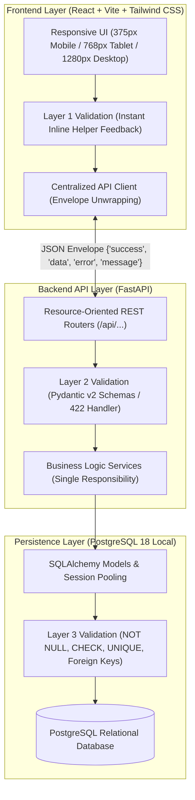

# System Architecture & Technical Decisions

This document outlines the architectural decisions, design patterns, and engineering rationale implemented in the solution, aligned with the **Odoo Hackathon Evaluator Scoring Rubric**.

---

## 1. System Architecture & End-to-End Flow

The system is architected as an offline-resilient, three-tier application emphasizing strict relational data modeling, domain modularity, and layered input validation.



---

## 2. Problem Framing & Operational Constraints

- **Scope Decision:** Focus exclusively on delivering one polished, end-to-end happy path rather than multiple shallow features.
- **Target Persona:** Operational users who require immediate data feedback, zero ambiguity in error handling, and fast, low-friction navigation.
- **Operational Constraints:**
  - Strict 8-hour sprint window.
  - 100% self-hosted, offline-capable local operation (no external cloud services or BaaS).
  - Strict responsive behavior across three target viewports: Mobile (375px), Tablet (768px), and Desktop (1280px).
- **Measurable Success Criteria:**
  1. Zero unvalidated data leakage into the database across all inputs.
  2. Sub-50ms local API response times with zero N+1 database queries.
  3. Immediate browser refresh reflecting PostgreSQL state dynamically (zero static mock JSON).

---

## 3. Domain Boundaries & Separation of Concerns

- **Module Ownership:** The system isolates responsibilities into distinct modules:
  - `backend/app/core/`: Configuration, database engines, connection poolers, and lifecycle management.
  - `backend/app/models/`: Relational schema declarations and persistent database constraints.
  - `backend/app/schemas/`: Typed Pydantic models for incoming payload validation and outgoing serialization.
  - `backend/app/services/`: Isolated business logic and transactional workflows.
  - `backend/app/routes/`: Transport layer handling HTTP routing, parameters, and status codes.
- **Communication Contracts:** The frontend communicates strictly via documented REST endpoints. Services never execute direct cross-domain mutations without designated service interfaces.
- **Unidirectional Dependency Flow:**
  $$\text{Frontend UI} \longrightarrow \text{REST Routers} \longrightarrow \text{Domain Services} \longrightarrow \text{SQLAlchemy Adapters} \longrightarrow \text{PostgreSQL}$$

---

## 4. Database Architecture & Relational Modeling (Core Scoring Priority)

Database design is treated as the primary technical foundation of the system:
- **3NF Normalization:** All relational entities are normalized to Third Normal Form (3NF) to eliminate data duplication and guarantee a single source of truth.
- **Referential Integrity:** Enforced via foreign key constraints with explicit `ON DELETE CASCADE` or `RESTRICT` rules to prevent orphaned records.
- **Indexing Strategy:** Primary keys and foreign keys are indexed by default; composite B-tree indexes are added to frequently filtered status fields and sorted timestamp columns.
- **N+1 Query Elimination:** All multi-entity relationships use SQLAlchemy `joinedload` or `selectinload` to fetch related entities in a single indexed query, eliminating round-trip latency.

---

## 5. API Design & Transport Contracts

- **Resource-Oriented REST:** Endpoints use resource nouns instead of actions (e.g., `/api/items`, not `/api/createItem`).
- **Semantic HTTP Verbs:** Strict adherence to standard semantics (`GET` for reading, `POST` for creation, `PATCH` for partial updates, `DELETE` for removal).
- **Standardized Response Envelope:** Every endpoint returns a consistent JSON envelope to ensure predictable client consumption:
  ```json
  {
    "success": true,
    "data": { ... },
    "error": null,
    "message": "Operation completed successfully"
  }
  ```
- **Semantic HTTP Status Codes:**
  - `200 OK` / `201 Created` for successful operations.
  - `400 Bad Request` for business logic contradictions.
  - `404 Not Found` when a requested entity does not exist.
  - `422 Unprocessable Entity` for schema/type validation failures with friendly field-level messages.
  - `500 Internal Server Error` for unexpected server exceptions.

---

## 6. The 3-Layer Validation Defense

To guarantee data integrity and provide clear, friendly user feedback, validation is implemented across three discrete layers:

| Layer | Implementation | Responsibility | User Feedback Mode |
|---|---|---|---|
| **Layer 1: Client** | React Form State & Regex | Immediate inline validation on change / blur | Friendly helper text (e.g., *"Please enter a valid email address"*). |
| **Layer 2: Server** | FastAPI & Pydantic v2 | Payload structure, data types, value boundaries | Standardized `422 Unprocessable Entity` response with field-level guidance. |
| **Layer 3: Database** | PostgreSQL Constraints | Permanent persistence defense (`NOT NULL`, `CHECK`, `UNIQUE`, FKs) | Immediate transaction rollback, preventing data corruption. |

---

## 7. Code Quality & Maintainability Standards

- **Single Responsibility Principle:** Every function executes exactly one well-defined job (readable in under two minutes).
- **Pure Functions:** Business calculations and formatters are deterministic pure functions (same inputs always yield identical outputs without side effects).
- **Framework Decoupling:** Business domain rules remain decoupled from web framework internals, allowing isolated automated testing.
- **Self-Documenting Code:** Clean identifier naming, clear variable semantics, and comments focusing on *why* a design decision was made rather than *what* the syntax is doing.

---

## 8. Failure Modes, Resilience & Key Trade-offs

### Handled Edge Cases
1. **Duplicate Submissions:** Caught by PostgreSQL `UNIQUE` constraints $\to$ translated into a friendly `400 Bad Request` message.
2. **Malformed Payloads:** Caught by Pydantic $\to$ translated into a descriptive `422` envelope detailing the exact field requiring correction.
3. **Temporary Network or Database Disconnects:** Handled gracefully by the client API service, displaying an offline banner without crashing the interface.

### Architectural Trade-off: Local PostgreSQL vs. Backend-as-a-Service (Firebase / Supabase)
- **Decision:** Build from scratch using local PostgreSQL and FastAPI.
- **Rationale:** While BaaS solutions offer rapid prototyping, they introduce external internet latency, rate limits, vendor lock-in, and unpredictable platform bugs. An offline-resilient local PostgreSQL stack showcases core relational engineering, query optimization, and total data sovereignty, directly matching the core philosophy of the hackathon evaluators.
