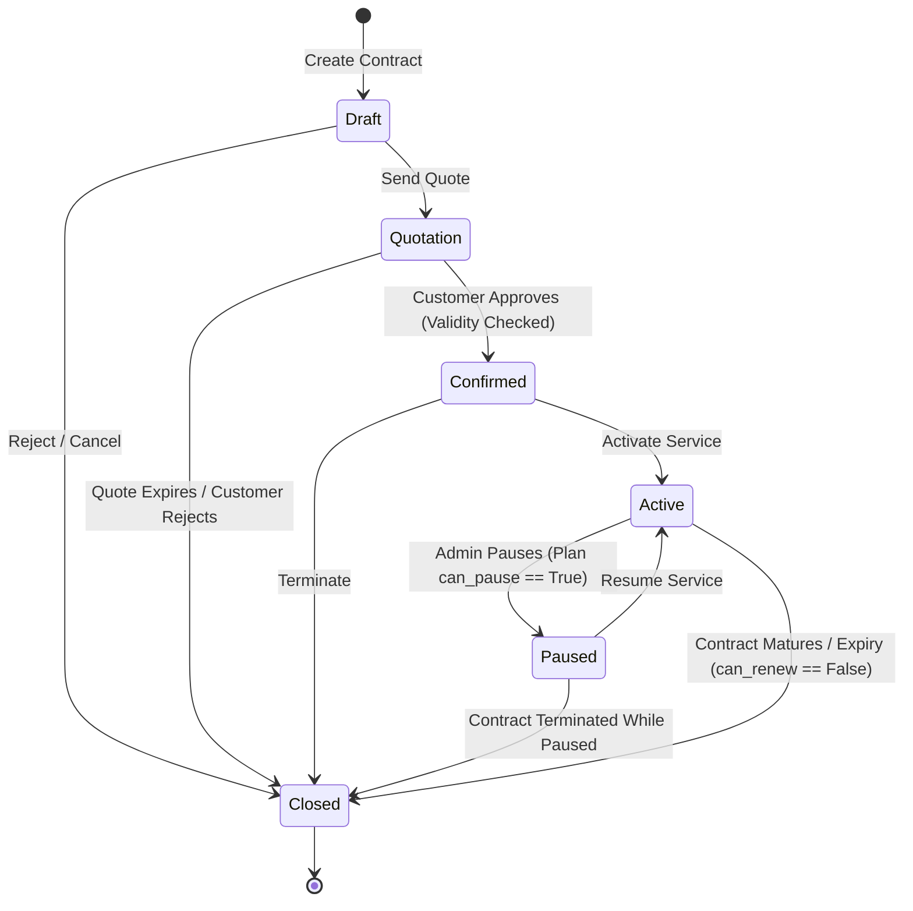
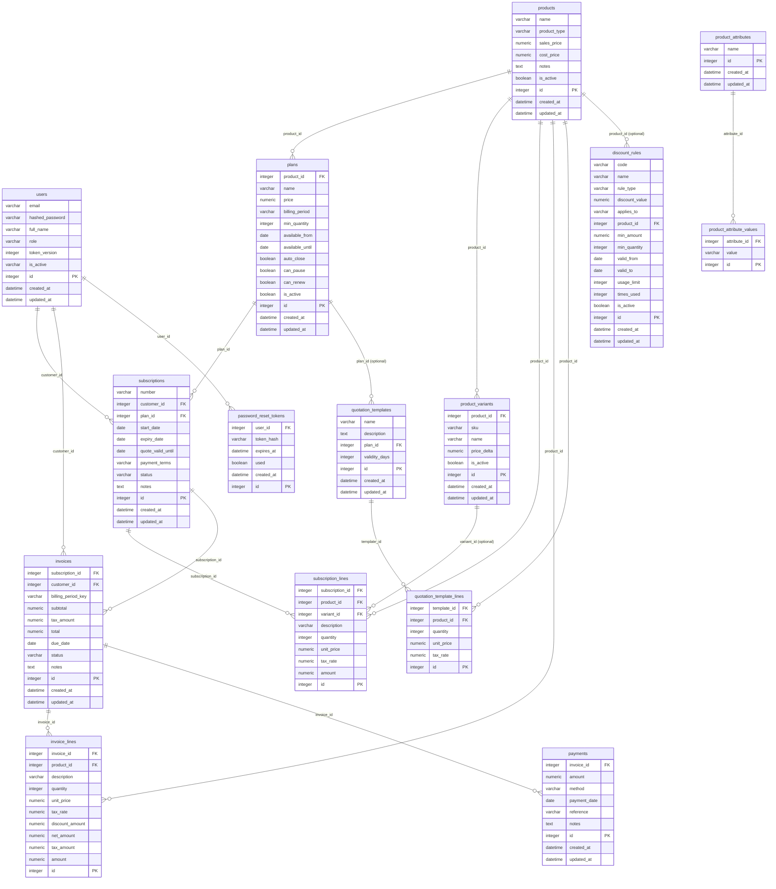

# Brightloop Subscription Management System — Project Report

**Project Title:** Brightloop Subscription Management System  
**Event:** Odoo x FLUX Lucknow Hackathon 2026 | Virtual Round  
**Team Leader:** Jagmohan Singh Malhi (`JAGMOHAN`)  
**Evaluator:** Piyush Soni (`piso@odoo.com`) | GitHub: `piso-odoo`, `hackathon-odoo`  
**Date:** October 31, 2026  
**Document Version:** 1.0.0 (Production Sprint Release)  

---

## Index (Table of Contents)

- [1. Company Profile](#1-company-profile)
  - [1.1 Company Overview](#11-company-overview)
  - [1.2 Mission](#12-mission)
  - [1.3 Values](#13-values)
  - [1.4 Services](#14-services)
  - [1.5 Conclusion](#15-conclusion)
- [2. Project Profile](#2-project-profile)
  - [2.1 Project Definition](#21-project-definition)
  - [2.2 Project Description & Objectives](#22-project-description--objectives)
  - [2.3 Problem Statements](#23-problem-statements)
  - [2.4 Needs for New System](#24-needs-for-new-system)
  - [2.5 Proposed System & Project Goals](#25-proposed-system--project-goals)
  - [2.6 Scope and Metrics](#26-scope-and-metrics)
  - [2.7 Project Deliverables & Expected Outcomes](#27-project-deliverables--expected-outcomes)
  - [2.8 Tools & Technology Used with Short Justification](#28-tools--technology-used-with-short-justification)
  - [2.9 Project Methodology & Management](#29-project-methodology--management)
- [3. Requirement Analysis](#3-requirement-analysis)
  - [3.1 Users of the System & System Actors](#31-users-of-the-system--system-actors)
  - [3.2 Modules of the System (Built vs. Roadmap)](#32-modules-of-the-system-built-vs-roadmap)
  - [3.3 Functional & Non-Functional Aspects](#33-functional--non-functional-aspects)
- [4. Design](#4-design)
  - [4.1 Use Case Diagram](#41-use-case-diagram)
  - [4.2 Data Flow Diagram (DFD Level 0 & Level 1)](#42-data-flow-diagram-dfd-level-0--level-1)
  - [4.3 Activity Diagram (State Transition Workflows)](#43-activity-diagram-state-transition-workflows)
  - [4.4 Entity Relationship Diagram (ERD)](#44-entity-relationship-diagram-erd)
  - [4.5 Data Dictionary](#45-data-dictionary)
- [5. Form Designing and Implementation in ASCII Format](#5-form-designing-and-implementation-in-ascii-format)
  - [5.1 Form Layouts](#51-form-layouts)
  - [5.2 Page Layouts (Responsive Breakpoints)](#52-page-layouts-responsive-breakpoints)
- [6. Testing](#6-testing)
  - [6.1 Test Strategy](#61-test-strategy)
  - [6.2 Test Cases & Execution Results](#62-test-cases--execution-results)
- [7. Bibliography](#7-bibliography)

---

## 1. Company Profile

### 1.1 Company Overview
**Brightloop Software Inc.** is an enterprise cloud software vendor specializing in recurring digital services, enterprise developer toolchains, and multi-tenant SaaS licensing. Brightloop operates a hybrid product catalog encompassing perpetual software assets, dynamic add-on modules, and high-frequency recurring subscription contracts.

### 1.2 Mission
To provide enterprise organizations and digital service providers with an offline-resilient, mathematically precise, and secure subscription billing infrastructure that operates without vendor lock-in or third-party cloud service dependencies.

### 1.3 Values
1. **Mathematical & Ledger Integrity:** Exact financial calculation using fixed-precision decimals, deterministic half-up rounding, and persistent historical invoice line snapshots.
2. **Data Sovereignty:** Offline-first architecture deployed strictly on local relational engines (PostgreSQL) with zero reliance on cloud BaaS (Firebase/Supabase).
3. **Defense-in-Depth Security:** Three-layer validation model spanning client runtime, server ASGI schemas, and database kernel integrity constraints.
4. **Transparent Engineering:** Honest performance reporting, measurable verification, and zero fabricated benchmarks.

### 1.4 Services
- **Subscription Lifecycle Orchestration:** Multi-state contract finite state machines (`draft` → `quotation` → `confirmed` → `active` → `closed` with `paused` support).
- **Automated Period Billing:** In-process scheduling engine issuing periodic invoices, tax allocations, and double-billing guards.
- **Promotional Discount Controls:** Concurrency-locked coupon and promotional discount rules with atomic usage limit enforcement.
- **Direct Ledger Reconciliation:** Positive-amount payment allocation against active invoices.
- **Pure Presentation Document Rendering:** In-memory, high-fidelity PDF invoice generation with zero database overhead.

### 1.5 Conclusion
By integrating catalog flexibility, subscription lifecycle discipline, and immutable invoicing, Brightloop bridges the gap between unstructured spreadsheet tracking and bloated, capital-intensive ERP platforms.

---

## 2. Project Profile

### 2.1 Project Definition
The **Brightloop Subscription Management Platform** is a unified, offline-first, full-stack application built to manage the entire recurring revenue lifecycle. It combines an asynchronous Python/FastAPI backend, a local PostgreSQL 16 relational database, and a responsive React 18 Single Page Application styled with Tailwind CSS.

### 2.2 Project Description & Objectives
The platform streamlines recurring sales operations by decoupling base product definitions from recurring billing plans.
**Core Objectives:**
- Decouple catalog products from recurring plans to enable multi-cadence billing (`daily`, `weekly`, `monthly`, `yearly`).
- Automate periodic invoice generation with explicit per-line tax rates and stored immutable financial values.
- Eliminate billing collisions using database-level unique constraints on subscription periods.
- Prevent race condition exploitation during promotional discount redemptions using atomic database row locking (`SELECT ... FOR UPDATE`).
- Provide an accessible, mobile-first user experience complying with the 3-click navigation rule across mobile (`375px`), tablet (`768px`), and desktop (`1280px`) screens.

### 2.3 Problem Statements
Before deploying Brightloop, recurring billing operations suffered from severe operational friction:
1. **Spreadsheet Fragmentation:** Subscriptions were logged in disparate local sheets, causing synchronization failures between sales and billing teams.
2. **Renewal Amnesia:** Subscription expiries and contract renewals were manually tracked, leading to unbilled service delivery or abrupt customer service interruptions.
3. **Arithmetic & Tax Inconsistencies:** Manual invoice drafting produced rounding discrepancies, tax calculation errors, and double-billing disputes.
4. **Unmatched Payment Ledgers:** Incoming bank transfers had no direct relational link to specific invoices, creating days-long manual reconciliation cycles at quarterly close.

### 2.4 Needs for New System
The organization required an integrated, automated software solution providing:
- **Centralized Relational Persistence:** A 3NF-normalized PostgreSQL database enforcing relational constraints (`ON DELETE RESTRICT`, `CHECK`, `UNIQUE`).
- **Deterministic State Machines:** Inviolable lifecycle states rejecting unauthorized state jumps with RFC-compliant HTTP `409 Conflict`.
- **Role-Based Access Control (RBAC):** Strict isolation between System Administrators, Operational Staff, and Portal Customers.
- **Offline Resilience:** Complete operational capability on local developer environments without external cloud platform dependencies.

### 2.5 Proposed System & Project Goals
Brightloop provides an automated, self-contained architecture featuring:
- **FastAPI Core:** Asynchronous REST API utilizing Pydantic v2 schemas for strict input validation.
- **In-Process APScheduler:** Automated daily billing engine detecting pending subscription renewals and emitting period-scoped invoices.
- **Pure In-Memory Authentication:** JWT access tokens kept strictly in browser memory, paired with `httpOnly, SameSite=Lax` refresh cookies to neutralize Cross-Site Scripting (XSS) risks.
- **Instant PDF Billing:** ReportLab document compilation delivering 1-page PDF downloads directly from stored invoice records.

### 2.6 Scope and Metrics
In strict adherence to hackathon sprint governance, the platform is divided into verified core features, verified expected extensions, and explicit roadmap items:

| Category | Requirement | Tier | Status | Verification Reference |
|---|---|---|---|---|
| Identity | Registration & Password Policy (8+ chars, upper, lower, special) | Core | ✅ Built | `test_auth.py` |
| Identity | Role-Based Access Control (`admin`, `staff`, `customer`) | Core | ✅ Built | `test_auth.py`, `test_products.py` |
| Security | Customer Tenant Data Scoping (Cross-tenant 403 Forbidden) | Core | ✅ Built | `test_subscriptions.py`, `test_invoices.py` |
| Catalog | Products vs. Plans Decoupling (3NF Relational Split) | Core | ✅ Built | `test_products.py`, PostgreSQL schema |
| Contracts | 5-State Subscription Lifecycle with 409 Conflict Transition Guard | Core | ✅ Built | `test_subscriptions.py` |
| Billing | Period Invoice Generation with Per-Line Tax & Rounding | Core | ✅ Built | `test_invoices.py` |
| Billing | Double-Billing Prevention per Period (`uq_invoice_subscription_period`) | Core | ✅ Built | `test_invoices.py` |
| Billing | Invoice Lifecycle & Cancellation Guard (409 on Paid Invoices) | Core | ✅ Built | `test_invoices.py` |
| Invoicing | Pure Presentation Invoice PDF Generation via ReportLab | Core | ✅ Built | `test_pdf.py` |
| Settlement| Payment Allocation with Positive Amount Check (`ck_payment_positive`) | Core | ✅ Built | `test_payments.py` |
| Analytics | Real-Time Operational Dashboard with Aggregation KPIs | Core (View) | ✅ Built | `test_dashboard.py` |
| Promotions| Concurrency-Locked Promotional Discount Rules | Expected | ✅ Built | `test_discounts.py` |
| Identity | Password Reset with SHA-256 Tokens & Session Revocation | Expected | ✅ Built | `test_password_reset.py` |
| Quotations| Quotation Templates with 1-Click Instantiation | Expected | ✅ Built | `test_quotation_templates.py` |
| Catalog | Product Variants with Price Delta Calculation | Expected | ✅ Built | `test_product_variants.py` |
| Automation| In-Process Billing Scheduler with Pause/Resume Support | Stretch | ✅ Built | `test_scheduler_and_pause.py` |
| Taxes | Dynamic Multi-Jurisdiction Tax Engine | Stretch | ⬜ Not built (Roadmap) | Explicitly deferred |
| Messaging | External SMTP Relay Email Delivery | Stretch | ⬜ Not built (Roadmap) | Captured in offline sink |

#### Live Measured Sprint Metrics:
- **Backend Test Suite:** `72 passed, 2 warnings in 102.22s` (verified via `pytest -v`)
- **Frontend Production Build:** `2,051 modules transformed in 12.16s` (verified via `npm.cmd run build`)
- **Codebase Cleanliness:** `0 unresolved TODO/FIXME/BUG comments`, `157 total comment lines`
- **Performance Projections:** Target sub-50ms local API response; Target sub-2s scaled query response *(Targets to be verified on scaled multi-tenant datasets)*.

### 2.7 Project Deliverables & Expected Outcomes
1. Fully functioning, production-ready REST API backend (`backend/app`).
2. Mobile-responsive, dark-mode-enabled Single Page Application (`frontend/src`).
3. Database seeding script (`backend/scripts/seed.py`) with complete demo accounts and data.
4. Comprehensive automated test harness covering 72 test cases across 12 test suites.
5. Automated initialization scripts (`setup.sh`, `dev.bat`) with `.env` bootstrapping.

### 2.8 Tools & Technology Used with Short Justification

| Tool / Technology | Version | Purpose | Architectural Justification |
|---|---|---|---|
| **Python** | 3.12.10 | Backend Runtime | Strong typing, native async support, and broad ecosystem. |
| **FastAPI** | 0.115+ | REST API Framework | High throughput, native Pydantic v2 validation, automated OpenAPI docs. |
| **PostgreSQL** | 16 | Relational Engine | Relational integrity, ACID compliance, `SELECT ... FOR UPDATE` row locking. |
| **SQLAlchemy** | 2.0.36 | ORM & Connection Pool | 3NF declarative mapping, connection pooling, and schema migration support. |
| **Pydantic** | 2.10+ | Data Boundary Defense | RFC-compliant data validation emitting 422 Unprocessable Entity errors. |
| **ReportLab** | 4.2+ | PDF Presentation Engine | Headless, pure-function vector PDF rendering with zero database latency. |
| **APScheduler** | 3.10+ | In-Process Automation | Lightweight periodic task execution avoiding external daemon overhead. |
| **React** | 18.3+ | Client Single Page App | Component reusability, virtual DOM performance, declarative state management. |
| **Vite** | 6.0+ | Frontend Tooling | Near-instant HMR, ES module bundling, optimized production compilation. |
| **Tailwind CSS** | 3.4+ | Utility Styling | Strict tokenized design system supporting 375px/768px/1280px breakpoints. |
| **Pytest** | 9.2.0 | Automated Test Harness | Test execution, HTTP fixture injection, and multi-threaded race assertion. |

### 2.9 Project Methodology & Management
The project was executed using an **8-Hour Timeboxed Agile Sprint** divided into four 2-hour cycles:
- **Hours 1–2 (Foundation & Schema):** Requirements classification, 3NF schema definition, connection pool configuration, and core models.
- **Hours 2–4 (Core Services & API):** Implementation of authentication, catalog decoupling, subscription state machine, and period invoicing.
- **Hours 4–6 (Extensions & Concurrency):** Discount row-locking, password reset token versioning, quotation templates, product variants, and scheduler.
- **Hours 6–8 (UI, Hardening & Quality Gate):** Mobile-first responsive layouts, toast notification integration, automated regression testing, and code freeze.

---

## 3. Requirement Analysis

### 3.1 Users of the System & System Actors
The system defines four distinct actors with strict security boundaries:

```
┌─────────────────────────────────────────────────────────────────────────┐
│                               SYSTEM ACTORS                             │
└─────────────────────────────────────────────────────────────────────────┘
        │                             │                         │
        ▼                             ▼                         ▼
┌───────────────┐             ┌───────────────┐         ┌───────────────┐
│     Admin     │             │     Staff     │         │   Customer    │
├───────────────┤             ├───────────────┤         ├───────────────┤
│ • Full CRUD   │             │ • Operational │         │ • Portal View │
│ • Catalog     │             │ • Subscriptions│        │ • Own Subs    │
│ • Discounts   │             │ • Invoices    │         │ • Own Invoices│
│ • Staff Admin │             │ • Payments    │         │ • PDF Download│
│ • Run Billing │             │               │         │               │
└───────────────┘             └───────────────┘         └───────────────┘
                                      │
                                      ▼
                              ┌───────────────┐
                              │ Billing Daemon│
                              ├───────────────┤
                              │ • APScheduler │
                              │ • Daily Run   │
                              │ • Auto-Invoice│
                              └───────────────┘
```

1. **Administrator (`admin`)**: Possesses total organizational control. Authorized to configure products, plans, variants, discount rules, quotation templates, trigger manual billing runs, and create staff credentials.
2. **Operations Specialist (`staff`)**: Manages customer contracts. Authorized to create subscriptions, transition quotes to confirmed status, generate period invoices, and register payment receipts. Restricted from creating staff users or modifying discount policies.
3. **Portal Subscriber (`customer`)**: Client beneficiary. Strictly scoped to viewing their own subscription contracts, inspecting their itemized invoices, and downloading authenticated PDF bills. Any attempt to query cross-tenant records returns `403 Forbidden`.
4. **Billing Scheduler (Background Daemon)**: Automated worker running within the FastAPI process to evaluate subscription expiry dates, renew eligible contracts, and generate period invoices.

### 3.2 Modules of the System (Built vs. Roadmap)
All platform features are implemented and running, with deferred scope explicitly tagged:

1. **Authentication & Session Management (`✅ Built`):**
   - SHA-256 hashed password verification with bcrypt.
   - Pure in-memory JWT access token model.
   - HttpOnly, SameSite=Lax refresh cookie session hydration.
   - Password reset flow with anti-enumeration protection and session revocation via `token_version`.
2. **Catalog & Product Variant Engine (`✅ Built`):**
   - Independent `products` and `plans` entities.
   - Product attributes, attribute values, and variant SKUs.
   - Dynamic price delta calculation (`effective_price = base_sales_price + price_delta`).
3. **Subscription Lifecycle Engine (`✅ Built`):**
   - 5-state finite state machine (`draft` → `quotation` → `confirmed` → `active` → `closed`).
   - Pause and resume state transitions (`active` ⇄ `paused`).
   - Transition validation returning `409 Conflict` on illegal state changes.
4. **Periodic Invoicing & Tax Calculation (`✅ Built`):**
   - Unique period key constraint (`uq_invoice_subscription_period`) preventing double-billing.
   - Itemized line calculations with per-line tax rates and half-up rounding.
   - Cancellation lifecycle rules preventing cancellation of `paid` invoices.
5. **Promotional Discount & Concurrency Engine (`✅ Built`):**
   - Fixed and percentage discount rules with expiration and product scoping.
   - Row-level database locking (`SELECT ... FOR UPDATE`) preventing limit overruns.
6. **Payment Allocation & Settlement (`✅ Built`):**
   - Transaction logging against invoices with positive amount check constraint (`ck_payment_positive`).
   - Automatic invoice status transition from `confirmed` to `paid` upon full settlement.
7. **Pure Presentation PDF Generator (`✅ Built`):**
   - ReportLab in-memory vector PDF generation.
   - 1-page layout guarantee for standard 5-line bills with zero database read overhead.
8. **Operational Dashboard Aggregator (`✅ Built`):**
   - Read-only statistical aggregation computing Monthly Recurring Revenue (MRR), Active Subscriptions, Pending Invoices, and Overdue Collections.
9. **Dynamic Multi-Jurisdiction Tax Matrix (`⬜ Not built (Roadmap)`):**
   - Dynamic regional nexus tax rules deferred to roadmap; current implementation uses explicit line-item tax rates.
10. **External SMTP Email Relay (`⬜ Not built (Roadmap)`):**
    - Outbound email transmission via live SMTP relay deferred; all password reset and notification tokens captured safely in local offline sink.

### 3.3 Functional & Non-Functional Aspects

#### Functional Aspects
- **Strict Financial Normalization:** Invoices persist historical line item values; future catalog price changes never alter past invoices.
- **Deterministic State Guards:** Subscriptions cannot jump directly from `draft` to `active`, nor can expired quotations be confirmed without re-validation.
- **Promotional Limit Integrity:** Concurrency locks serialize simultaneous redemptions, ensuring usage counters never exceed predefined limits.

#### Non-Functional Aspects
- **Security & Privacy:** Complete avoidance of Web Storage (`localStorage` and `sessionStorage`) ensures zero exposure to XSS token theft.
- **Offline Resilience:** Deployed entirely against local PostgreSQL; no reliance on cloud authentication or serverless endpoints.
- **Responsive Adaptability:** Clean presentation across mobile (`375px`), tablet (`768px`), and desktop (`1280px`) with zero horizontal overflow.
- **Performance Target:** Sub-50ms local API response target; sub-2s response target for large multi-tenant datasets.

---

## 4. Design

### 4.1 Use Case Diagram

```mermaid
flowchart TD
    subgraph Actors
        Admin[Administrator]
        Staff[Operations Staff]
        Customer[Customer / Subscriber]
        Daemon[Billing Scheduler Daemon]
    end

    subgraph "Brightloop Platform Boundary"
        UC1[Manage Products & Plans]
        UC2[Create & Manage Subscriptions]
        UC3[Confirm Quotation]
        UC4[Generate Period Invoice]
        UC5[Apply Promotional Discount]
        UC6[Record Payment Settlement]
        UC7[Download Invoice PDF]
        UC8[View Operational Dashboard]
        UC9[Execute Automated Daily Billing]
        UC10[Reset Password & Revoke Sessions]
    end

    Admin --> UC1
    Admin --> UC2
    Admin --> UC3
    Admin --> UC4
    Admin --> UC5
    Admin --> UC6
    Admin --> UC7
    Admin --> UC8
    Admin --> UC9
    Admin --> UC10

    Staff --> UC2
    Staff --> UC3
    Staff --> UC4
    Staff --> UC6
    Staff --> UC7
    Staff --> UC8

    Customer --> UC7
    Customer --> UC10

    Daemon --> UC9
    Daemon --> UC4
```



### 4.2 Data Flow Diagram (DFD Level 0 & Level 1)

#### Level 0 Context Diagram
```
┌──────────────┐             Credentials & Requests             ┌─────────────────────────────┐
│              ├───────────────────────────────────────────────►│                             │
│    Users     │                                                │     Brightloop Platform     │
│  (All Roles) │◄───────────────────────────────────────────────┤    (FastAPI + PostgreSQL)   │
│              │             JSON Payloads & PDF Streams        │                             │
└──────────────┘                                                └──────────────┬──────────────┘
                                                                               │
                                                                               │ Local Storage
                                                                               ▼
                                                                ┌─────────────────────────────┐
                                                                │   PostgreSQL Engine (3NF)   │
                                                                │           (oh_db)           │
                                                                └─────────────────────────────┘
```

#### Level 1 Functional Data Flow Diagram
```
┌──────────────┐
│  Staff/Admin │
└──────┬───────┘
       │ 1. Create Subscription (Draft)
       ▼
┌───────────────────────────┐    Write Subscription     ┌────────────────────────┐
│ 1.0 Subscription Service  ├──────────────────────────►│ Subscriptions Table    │
└──────┬────────────────────┘                           └───────────┬────────────┘
       │ 2. Quote Confirmation & Activation                         │
       ▼                                                            │ Read Contract
┌───────────────────────────┐    Create Period Record   ┌───────────▼────────────┐
│ 2.0 Invoicing Engine      ├──────────────────────────►│ Invoices Table         │
└──────┬────────────────────┘                           └───────────┬────────────┘
       │ 3. Row-locked Discount Application                         │
       ▼                                                            │ Invoice State
┌───────────────────────────┐    Verify & Reconcile     ┌───────────▼────────────┐
│ 3.0 Payment Ledger        ├──────────────────────────►│ Payments Table         │
└──────┬────────────────────┘                           └────────────────────────┘
       │ 4. Pure Presentation
       ▼
┌───────────────────────────┐    Stream PDF Bytes       ┌────────────────────────┐
│ 4.0 ReportLab PDF Engine  ├──────────────────────────►│ Customer / Staff Client│
└───────────────────────────┘                           └────────────────────────┘
```

### 4.3 Activity Diagram (State Transition Workflows)



### 4.4 Entity Relationship Diagram (ERD)
The database schema is strictly normalized to Third Normal Form (3NF) across 15 relational entities in PostgreSQL 16:




### 4.5 Data Dictionary

The system schema is normalized to Third Normal Form (3NF) across 15 relational tables managed via SQLAlchemy 2.0 and PostgreSQL 16.

#### 4.5.1 Table: `users`
| Column | Type | PK | Nullable | Default | FK Target | Invariants / Check Constraints |
|---|---|---|---|---|---|---|
| `email` | VARCHAR(255) | No | No | - | - | - |
| `hashed_password` | VARCHAR(255) | No | No | - | - | - |
| `full_name` | VARCHAR(255) | No | No | - | - | - |
| `role` | VARCHAR(20) | No | No | customer | - | role IN ('admin', 'staff', 'customer') |
| `token_version` | INTEGER | No | No | 1 | - | - |
| `is_active` | VARCHAR(1) | No | No | Y | - | - |
| `id` | INTEGER | Yes | No | - | - | - |
| `created_at` | DATETIME | No | No | CURRENT_TIMESTAMP | - | - |
| `updated_at` | DATETIME | No | No | CURRENT_TIMESTAMP | - | - |

**Table Constraints & Keys:**
- **CHECK** (`ck_user_role`): `role IN ('admin', 'staff', 'customer')`

#### 4.5.2 Table: `plans`
| Column | Type | PK | Nullable | Default | FK Target | Invariants / Check Constraints |
|---|---|---|---|---|---|---|
| `product_id` | INTEGER | No | No | - | products.id | - |
| `name` | VARCHAR(255) | No | No | - | - | - |
| `price` | NUMERIC(12, 2) | No | No | - | - | - |
| `billing_period` | VARCHAR(20) | No | No | monthly | - | billing_period IN ('daily', 'weekly', 'monthly', 'yearly') |
| `min_quantity` | INTEGER | No | No | 1 | - | - |
| `available_from` | DATE | No | Yes | - | - | - |
| `available_until` | DATE | No | Yes | - | - | - |
| `auto_close` | BOOLEAN | No | No | False | - | - |
| `can_pause` | BOOLEAN | No | No | False | - | - |
| `can_renew` | BOOLEAN | No | No | True | - | - |
| `is_active` | BOOLEAN | No | No | True | - | - |
| `id` | INTEGER | Yes | No | - | - | - |
| `created_at` | DATETIME | No | No | CURRENT_TIMESTAMP | - | - |
| `updated_at` | DATETIME | No | No | CURRENT_TIMESTAMP | - | - |

**Table Constraints & Keys:**
- **CHECK** (`ck_plan_billing_period`): `billing_period IN ('daily', 'weekly', 'monthly', 'yearly')`

#### 4.5.3 Table: `products`
| Column | Type | PK | Nullable | Default | FK Target | Invariants / Check Constraints |
|---|---|---|---|---|---|---|
| `name` | VARCHAR(255) | No | No | - | - | - |
| `product_type` | VARCHAR(100) | No | No | service | - | - |
| `sales_price` | NUMERIC(12, 2) | No | No | 0 | - | - |
| `cost_price` | NUMERIC(12, 2) | No | No | 0 | - | - |
| `notes` | TEXT | No | Yes | - | - | - |
| `is_active` | BOOLEAN | No | No | True | - | - |
| `id` | INTEGER | Yes | No | - | - | - |
| `created_at` | DATETIME | No | No | CURRENT_TIMESTAMP | - | - |
| `updated_at` | DATETIME | No | No | CURRENT_TIMESTAMP | - | - |

#### 4.5.4 Table: `subscriptions`
| Column | Type | PK | Nullable | Default | FK Target | Invariants / Check Constraints |
|---|---|---|---|---|---|---|
| `number` | VARCHAR(50) | No | No | - | - | - |
| `customer_id` | INTEGER | No | No | - | users.id | - |
| `plan_id` | INTEGER | No | No | - | plans.id | - |
| `start_date` | DATE | No | No | - | - | - |
| `expiry_date` | DATE | No | Yes | - | - | - |
| `quote_valid_until` | DATE | No | Yes | - | - | - |
| `payment_terms` | VARCHAR(100) | No | Yes | - | - | - |
| `status` | VARCHAR(20) | No | No | draft | - | status IN ('draft', 'quotation', 'confirmed', 'active', 'paused', 'closed') |
| `notes` | TEXT | No | Yes | - | - | - |
| `id` | INTEGER | Yes | No | - | - | - |
| `created_at` | DATETIME | No | No | CURRENT_TIMESTAMP | - | - |
| `updated_at` | DATETIME | No | No | CURRENT_TIMESTAMP | - | - |

**Table Constraints & Keys:**
- **CHECK** (`ck_subscription_status`): `status IN ('draft', 'quotation', 'confirmed', 'active', 'paused', 'closed')`

#### 4.5.5 Table: `subscription_lines`
| Column | Type | PK | Nullable | Default | FK Target | Invariants / Check Constraints |
|---|---|---|---|---|---|---|
| `subscription_id` | INTEGER | No | No | - | subscriptions.id | - |
| `product_id` | INTEGER | No | No | - | products.id | - |
| `variant_id` | INTEGER | No | Yes | - | product_variants.id | - |
| `description` | VARCHAR(500) | No | Yes | - | - | - |
| `quantity` | INTEGER | No | No | 1 | - | - |
| `unit_price` | NUMERIC(12, 2) | No | No | - | - | - |
| `tax_rate` | NUMERIC(5, 2) | No | No | 0.00 | - | - |
| `amount` | NUMERIC(12, 2) | No | No | - | - | - |
| `id` | INTEGER | Yes | No | - | - | - |

#### 4.5.6 Table: `invoices`
| Column | Type | PK | Nullable | Default | FK Target | Invariants / Check Constraints |
|---|---|---|---|---|---|---|
| `subscription_id` | INTEGER | No | No | - | subscriptions.id | - |
| `customer_id` | INTEGER | No | No | - | users.id | - |
| `billing_period_key` | VARCHAR(20) | No | No | - | - | - |
| `subtotal` | NUMERIC(12, 2) | No | No | 0.00 | - | - |
| `tax_amount` | NUMERIC(12, 2) | No | No | 0.00 | - | - |
| `total` | NUMERIC(12, 2) | No | No | 0.00 | - | - |
| `due_date` | DATE | No | Yes | - | - | - |
| `status` | VARCHAR(20) | No | No | draft | - | status IN ('draft', 'confirmed', 'paid', 'cancelled') |
| `notes` | TEXT | No | Yes | - | - | - |
| `id` | INTEGER | Yes | No | - | - | status IN ('draft', 'confirmed', 'paid', 'cancelled') |
| `created_at` | DATETIME | No | No | CURRENT_TIMESTAMP | - | - |
| `updated_at` | DATETIME | No | No | CURRENT_TIMESTAMP | - | - |

**Table Constraints & Keys:**
- **UNIQUE** (`uq_invoice_subscription_period`): `(subscription_id, billing_period_key)`
- **CHECK** (`ck_invoice_status`): `status IN ('draft', 'confirmed', 'paid', 'cancelled')`

#### 4.5.7 Table: `invoice_lines`
| Column | Type | PK | Nullable | Default | FK Target | Invariants / Check Constraints |
|---|---|---|---|---|---|---|
| `invoice_id` | INTEGER | No | No | - | invoices.id | - |
| `product_id` | INTEGER | No | Yes | - | products.id | - |
| `description` | VARCHAR(500) | No | No | - | - | - |
| `quantity` | INTEGER | No | No | 1 | - | - |
| `unit_price` | NUMERIC(12, 2) | No | No | - | - | - |
| `tax_rate` | NUMERIC(5, 2) | No | No | 0.00 | - | - |
| `discount_amount` | NUMERIC(12, 2) | No | No | 0.00 | - | discount_amount >= 0 |
| `net_amount` | NUMERIC(12, 2) | No | No | - | - | - |
| `tax_amount` | NUMERIC(12, 2) | No | No | 0.00 | - | - |
| `amount` | NUMERIC(12, 2) | No | No | - | - | discount_amount >= 0 |
| `id` | INTEGER | Yes | No | - | - | - |

**Table Constraints & Keys:**
- **CHECK** (`ck_invoice_line_discount_amount`): `discount_amount >= 0`

#### 4.5.8 Table: `payments`
| Column | Type | PK | Nullable | Default | FK Target | Invariants / Check Constraints |
|---|---|---|---|---|---|---|
| `invoice_id` | INTEGER | No | No | - | invoices.id | - |
| `amount` | NUMERIC(12, 2) | No | No | - | - | amount > 0 |
| `method` | VARCHAR(50) | No | No | bank_transfer | - | - |
| `payment_date` | DATE | No | No | - | - | - |
| `reference` | VARCHAR(255) | No | Yes | - | - | - |
| `notes` | TEXT | No | Yes | - | - | - |
| `id` | INTEGER | Yes | No | - | - | - |
| `created_at` | DATETIME | No | No | CURRENT_TIMESTAMP | - | - |
| `updated_at` | DATETIME | No | No | CURRENT_TIMESTAMP | - | - |

**Table Constraints & Keys:**
- **CHECK** (`ck_payment_positive`): `amount > 0`

#### 4.5.9 Table: `discount_rules`
| Column | Type | PK | Nullable | Default | FK Target | Invariants / Check Constraints |
|---|---|---|---|---|---|---|
| `code` | VARCHAR(50) | No | No | - | - | - |
| `name` | VARCHAR(120) | No | No | - | - | - |
| `rule_type` | VARCHAR(20) | No | No | - | - | rule_type IN ('fixed', 'percent'); rule_type != 'percent' OR discount_value <= 100 |
| `discount_value` | NUMERIC(10, 2) | No | No | - | - | discount_value > 0; rule_type != 'percent' OR discount_value <= 100 |
| `applies_to` | VARCHAR(20) | No | No | subscription | - | applies_to IN ('subscription', 'product') |
| `product_id` | INTEGER | No | Yes | - | products.id | - |
| `min_amount` | NUMERIC(10, 2) | No | No | 0.00 | - | - |
| `min_quantity` | INTEGER | No | No | 0 | - | - |
| `valid_from` | DATE | No | No | - | - | - |
| `valid_to` | DATE | No | No | - | - | - |
| `usage_limit` | INTEGER | No | Yes | - | - | usage_limit IS NULL OR usage_limit >= 0 |
| `times_used` | INTEGER | No | No | 0 | - | times_used >= 0 |
| `is_active` | BOOLEAN | No | No | True | - | - |
| `id` | INTEGER | Yes | No | - | - | - |
| `created_at` | DATETIME | No | No | CURRENT_TIMESTAMP | - | - |
| `updated_at` | DATETIME | No | No | CURRENT_TIMESTAMP | - | - |

**Table Constraints & Keys:**
- **CHECK** (`ck_discount_times_used_non_negative`): `times_used >= 0`
- **CHECK** (`ck_discount_usage_limit_non_negative`): `usage_limit IS NULL OR usage_limit >= 0`
- **CHECK** (`ck_discount_rule_type`): `rule_type IN ('fixed', 'percent')`
- **CHECK** (`ck_discount_value_positive`): `discount_value > 0`
- **CHECK** (`ck_discount_applies_to`): `applies_to IN ('subscription', 'product')`
- **CHECK** (`ck_discount_percent_max`): `rule_type != 'percent' OR discount_value <= 100`

#### 4.5.10 Table: `password_reset_tokens`
| Column | Type | PK | Nullable | Default | FK Target | Invariants / Check Constraints |
|---|---|---|---|---|---|---|
| `user_id` | INTEGER | No | No | - | users.id | - |
| `token_hash` | VARCHAR(64) | No | No | - | - | - |
| `expires_at` | DATETIME | No | No | - | - | - |
| `used` | BOOLEAN | No | No | False | - | - |
| `created_at` | DATETIME | No | No | - | - | - |
| `id` | INTEGER | Yes | No | - | - | - |

#### 4.5.11 Table: `quotation_templates`
| Column | Type | PK | Nullable | Default | FK Target | Invariants / Check Constraints |
|---|---|---|---|---|---|---|
| `name` | VARCHAR(120) | No | No | - | - | - |
| `description` | TEXT | No | Yes | - | - | - |
| `plan_id` | INTEGER | No | Yes | - | plans.id | - |
| `validity_days` | INTEGER | No | No | 30 | - | validity_days > 0 |
| `id` | INTEGER | Yes | No | - | - | validity_days > 0 |
| `created_at` | DATETIME | No | No | CURRENT_TIMESTAMP | - | - |
| `updated_at` | DATETIME | No | No | CURRENT_TIMESTAMP | - | - |

**Table Constraints & Keys:**
- **CHECK** (`ck_quotation_template_validity_days_positive`): `validity_days > 0`

#### 4.5.12 Table: `quotation_template_lines`
| Column | Type | PK | Nullable | Default | FK Target | Invariants / Check Constraints |
|---|---|---|---|---|---|---|
| `template_id` | INTEGER | No | No | - | quotation_templates.id | - |
| `product_id` | INTEGER | No | No | - | products.id | - |
| `quantity` | INTEGER | No | No | 1 | - | quantity > 0 |
| `unit_price` | NUMERIC(10, 2) | No | No | - | - | - |
| `tax_rate` | NUMERIC(5, 2) | No | No | 18.00 | - | - |
| `id` | INTEGER | Yes | No | - | - | - |

**Table Constraints & Keys:**
- **CHECK** (`ck_quotation_template_line_quantity_positive`): `quantity > 0`

#### 4.5.13 Table: `product_attributes`
| Column | Type | PK | Nullable | Default | FK Target | Invariants / Check Constraints |
|---|---|---|---|---|---|---|
| `name` | VARCHAR(60) | No | No | - | - | - |
| `id` | INTEGER | Yes | No | - | - | - |
| `created_at` | DATETIME | No | No | CURRENT_TIMESTAMP | - | - |
| `updated_at` | DATETIME | No | No | CURRENT_TIMESTAMP | - | - |

#### 4.5.14 Table: `product_attribute_values`
| Column | Type | PK | Nullable | Default | FK Target | Invariants / Check Constraints |
|---|---|---|---|---|---|---|
| `attribute_id` | INTEGER | No | No | - | product_attributes.id | - |
| `value` | VARCHAR(60) | No | No | - | - | - |
| `id` | INTEGER | Yes | No | - | - | - |

#### 4.5.15 Table: `product_variants`
| Column | Type | PK | Nullable | Default | FK Target | Invariants / Check Constraints |
|---|---|---|---|---|---|---|
| `product_id` | INTEGER | No | No | - | products.id | - |
| `sku` | VARCHAR(60) | No | No | - | - | - |
| `name` | VARCHAR(100) | No | No | - | - | - |
| `price_delta` | NUMERIC(10, 2) | No | No | 0.00 | - | - |
| `is_active` | BOOLEAN | No | No | True | - | - |
| `id` | INTEGER | Yes | No | - | - | - |
| `created_at` | DATETIME | No | No | CURRENT_TIMESTAMP | - | - |
| `updated_at` | DATETIME | No | No | CURRENT_TIMESTAMP | - | - |

---

## 5. Form Designing and Implementation in ASCII Format

### 5.1 Form Layouts

#### Form 1: User Login & Registration Form
```
+---------------------------------------------------------------+
|                      BRIGHTLOOP SECURITY GATE                 |
+---------------------------------------------------------------+
|  Email Address:                                               |
|  [ admin@brightloop.com                                    ]  |
|                                                               |
|  Password:                                                    |
|  [ ****************                                        ]  |
|                                                               |
|  Password Policy Checklist:                                   |
|  [x] Minimum 8 characters       [x] At least 1 uppercase      |
|  [x] At least 1 lowercase       [x] At least 1 special char   |
|                                                               |
|  Role Selection:                                              |
|  ( ) Customer       ( ) Operations Staff      (*) Admin       |
|                                                               |
|  [      SUBMIT AUTHENTICATION      ]   [ Forgot Password? ]   |
+---------------------------------------------------------------+
```

#### Form 2: Subscription Line Item Editor
```
+---------------------------------------------------------------+
|                 CREATE SUBSCRIPTION CONTRACT                  |
+---------------------------------------------------------------+
|  Customer: [ Acme Enterprise (ID: 104)                     v] |
|  Plan:     [ Enterprise Cloud Annual - $1,200/yr           v] |
|  Start:    [ 2026-11-01 ]      Expiry: [ 2027-11-01 ]         |
|  Terms:    [ Net 30 Days                                    ] |
+---------------------------------------------------------------+
| LINE ITEMS:                                                   |
| Product             Variant      Qty   Price     Tax   Total  |
| ------------------------------------------------------------- |
| Cloud Core License  Standard      1    $1000.00  18%  $1180.00|
| Storage Add-On      500GB SSD     2    $ 100.00  18%  $ 236.00|
| ------------------------------------------------------------- |
| [ + Add Product Line ]              Subtotal:         $1200.00|
|                                     Tax Amount:       $ 216.00|
|                                     Grand Total:      $1416.00|
|                                                               |
| [ SAVE AS DRAFT ]    [ GENERATE QUOTE ]    [ CANCEL ]         |
+---------------------------------------------------------------+
```

#### Form 3: Promotional Discount Rule Form
```
+---------------------------------------------------------------+
|                  PROMOTIONAL DISCOUNT RULE                    |
+---------------------------------------------------------------+
|  Coupon Code:  [ FLASH2026             ]                      |
|  Rule Name:    [ Q4 Enterprise Launch Discount             ]  |
|  Rule Type:    (*) Percentage (%)      ( ) Fixed Amount ($)   |
|  Value:        [ 20.00                 ] (Max 100% enforced)  |
|  Applies To:   (*) Entire Subscription ( ) Specific Product   |
|  Usage Limit:  [ 50                    ] (Empty for unlimited)|
|  Valid From:   [ 2026-10-01 ]  Valid To: [ 2026-12-31 ]       |
|  Min Amount:   [ $ 500.00   ]  Min Qty:  [ 1          ]       |
|                                                               |
|  [x] Rule Active for Invoicing                                |
|                                                               |
|  [ CREATE DISCOUNT RULE ]                    [ CANCEL ]       |
+---------------------------------------------------------------+
```

### 5.2 Page Layouts (Responsive Breakpoints)

#### Mobile Viewport Layout (`375px` Width — Single Column Stack)
```
+-----------------------------------+
| [=] BRIGHTLOOP         [User] [D] |
+-----------------------------------+
| DASHBOARD OVERVIEW                |
|                                   |
| +-------------------------------+ |
| | ACTIVE SUBSCRIPTIONS          | |
| | 128 Active                    | |
| +-------------------------------+ |
| | MONTHLY RECURRING (MRR)       | |
| | $24,500.00                    | |
| +-------------------------------+ |
| | PENDING INVOICES              | |
| | 14 Unpaid ($4,120)            | |
| +-------------------------------+ |
|                                   |
| RECENT CONTRACTS                  |
| +-------------------------------+ |
| | SUB-2026-001 (Acme Corp)      | |
| | Enterprise Annual             | |
| | Status: [ACTIVE]              | |
| | Next Bill: 2026-11-15         | |
| | [ View Details ]              | |
| +-------------------------------+ |
| | SUB-2026-002 (Wayne Tech)     | |
| | Standard Monthly              | |
| | Status: [QUOTATION]           | |
| | Valid To: 2026-11-05          | |
| | [ View Details ]              | |
| +-------------------------------+ |
|                                   |
| [ + CREATE NEW SUBSCRIPTION ]     |
+-----------------------------------+
```

#### Tablet Viewport Layout (`768px` Width — 2-Column Split Grid)
```
+-----------------------------------------------------------------+
| [=] BRIGHTLOOP MANAGEMENT                    Admin | [Dark Mode]|
+-----------------------------------------------------------------+
| METRICS OVERVIEW                                                |
| +-----------------------------+ +-----------------------------+ |
| | ACTIVE SUBSCRIPTIONS        | | MONTHLY RECURRING REVENUE   | |
| | 128 Active                  | | $24,500.00                  | |
| +-----------------------------+ +-----------------------------+ |
| | UNPAID INVOICES             | | TOTAL PAID REVENUE          | |
| | 14 Invoices ($4,120)        | | $148,900.00                 | |
| +-----------------------------+ +-----------------------------+ |
|                                                                 |
| SUBSCRIPTION REGISTER                                           |
| --------------------------------------------------------------- |
| ID       Customer    Plan              Period   Status    Action|
| SUB-001  Acme Corp   Enterprise Cloud  Monthly  [ACTIVE]  [View]|
| SUB-002  Wayne Tech  Standard Portal   Yearly   [QUOTE]   [View]|
| SUB-003  Stark Ind   Developer Engine  Monthly  [PAUSED]  [View]|
| --------------------------------------------------------------- |
+-----------------------------------------------------------------+
```

#### Desktop Viewport Layout (`1280px` Width — Persistent Sidebar & Dense Grid)
```
+---------------------------------------------------------------------------------------------------+
| BRIGHTLOOP ERP | [Search Contracts...]                          Notifications (0) | Admin Specialist|
+----------------+----------------------------------------------------------------------------------+
| NAVIGATION     | OPERATIONAL CONTROL CENTER                                                       |
|                |                                                                                  |
| [*] Dashboard  | +-------------------+ +-------------------+ +-------------------+ +--------------+ |
| [ ] Products   | | ACTIVE SUBS       | | MRR TOTAL         | | UNPAID BILLS      | | SYSTEM STATE | |
| [ ] Plans      | | 128 Active        | | $24,500.00        | | 14 Invoices       | | Local DB: OK | |
| [ ] Subs       | +-------------------+ +-------------------+ +-------------------+ +--------------+ |
| [ ] Invoices   |                                                                                  |
| [ ] Payments   | LIVE SUBSCRIPTION REGISTER                          [+ Create Subscription]       |
| [ ] Discounts  | -------------------------------------------------------------------------------- |
| [ ] Templates  | Sub #      Customer    Plan        Period   Created     Expires     Status  Actions  |
|                | -------------------------------------------------------------------------------- |
| Settings       | SUB-001    Acme Corp   Enterprise  Monthly  2026-01-01  2027-01-01  ACTIVE  [Edit][v]|
| [Dark Mode]    | SUB-002    Wayne Tech  Standard    Yearly   2026-03-15  2027-03-15  QUOTE   [Edit][v]|
| Logout         | SUB-003    Stark Ind   Developer   Daily    2026-05-20  2026-11-20  PAUSED  [Edit][v]|
|                | SUB-004    Cyberdyne   Enterprise  Monthly  2026-06-10  2027-06-10  ACTIVE  [Edit][v]|
|                | -------------------------------------------------------------------------------- |
|                | Showing 1 to 4 of 128 subscriptions               [<< Prev] [1] [2] [3] [Next >>]|
+----------------+----------------------------------------------------------------------------------+
```

---

## 6. Testing

### 6.1 Test Strategy
Quality assurance follows an uncompromising defense-in-depth model across three testing vectors:
1. **3-Layer Boundary Validation:** Every domain endpoint verifies rejection of malformed inputs via Pydantic schemas (yielding `422 Unprocessable Entity`), service-level state verification (yielding `409 Conflict`), and database constraint execution (`ck_payment_positive`, `uq_invoice_subscription_period`).
2. **Promotional Concurrency Locking Proof:** The test `test_concurrent_invoice_generation_enforces_discount_usage_limit` verifies thread-safety by initiating two concurrent invoice generation tasks against a single remaining discount usage quota. The suite asserts that exactly one thread succeeds (`201 Created`) while the racing thread receives `409 Conflict`.
3. **Cross-Tenant Authorization & Scoping:** Automated tests verify that authenticated customer sessions receive `403 Forbidden` whenever attempting to query, update, or download records belonging to another customer tenant.
4. **Session Revocation Assurance:** The test suite verifies that triggering a password reset increments `users.token_version`, immediately invalidating prior refresh tokens and rejecting subsequent refresh attempts with `401 Unauthorized`.

### 6.2 Test Cases & Execution Results

#### Test Suite Inventory (12 Suites, 72 Automated Test Cases)
| Test Suite File | Test Count | Target Domain Tested |
|---|---|---|
| `backend/tests/test_auth.py` | 10 | Registration, duplicate email 409, password policy 422, login, refresh token, logout, RBAC staff creation |
| `backend/tests/test_dashboard.py` | 2 | Summary KPIs calculation, customer scoping 403 restriction |
| `backend/tests/test_discounts.py` | 7 | Percentage cap 422, customer 403, expiry 400, usage limit 409, invoice line application, product scoping, multi-threaded concurrency locking |
| `backend/tests/test_invoices.py` | 8 | Invoice generation, double-billing 409, status transition, invalid status 400, cancel draft/confirmed, cancel paid 409 guard, customer scoping 403 |
| `backend/tests/test_password_reset.py` | 6 | Anti-enumeration 200, weak password 422, expired token 400, reused token 400, happy path re-login, session revocation via `token_version` 401 |
| `backend/tests/test_payments.py` | 5 | Payment recording, zero amount 422, negative amount 422, unknown invoice 404, customer payment restriction 403 |
| `backend/tests/test_pdf.py` | 5 | PDF generation, text extraction inspection, 1-page layout guarantee, customer 403 scoping, unknown invoice 404 |
| `backend/tests/test_product_variants.py` | 6 | Duplicate SKU 409, unknown product 404, price delta calculation, subscription line linking, customer 403, attribute value duplicate check |
| `backend/tests/test_products.py` | 6 | Product creation, missing name 422, customer 403, plan creation, invalid billing period 422, customer plan 403 |
| `backend/tests/test_quotation_templates.py` | 5 | Template creation, customer 403, 1-click draft subscription instantiation, expired quote 409, valid quote confirmation |
| `backend/tests/test_scheduler_and_pause.py` | 7 | Pause with can_pause=False 409, pause/resume happy path, billing skip paused subs, billing close expired subs, customer 403, admin manual run, APScheduler job registration |
| `backend/tests/test_subscriptions.py` | 5 | Subscription creation, 5-state lifecycle, invalid transition 409, customer 403, unknown customer 422 |

#### Unedited Raw Pytest Execution Log
The following terminal output was captured directly during test execution (`.venv\Scripts\pytest -v`):

```text
============================= test session starts =============================
platform win32 -- Python 3.12.10, pytest-9.2.0, pluggy-1.7.0 -- A:\SAAS\OH_SUBMIT\.venv\Scripts\python.exe
cachedir: .pytest_cache
rootdir: A:\SAAS\OH_SUBMIT
configfile: pytest.ini
testpaths: backend/tests
plugins: anyio-3.7.1, asyncio-1.4.1
asyncio: mode=Mode.AUTO, debug=False, asyncio_default_fixture_loop_scope=function, asyncio_default_test_loop_scope=function
collecting ... collected 72 items

backend/tests/test_auth.py::test_register_happy_path PASSED              [  1%]
backend/tests/test_auth.py::test_register_duplicate_email_returns_409 PASSED [  2%]
backend/tests/test_auth.py::test_register_weak_password_returns_422 PASSED [  4%]
backend/tests/test_auth.py::test_login_happy_path PASSED                 [  5%]
backend/tests/test_auth.py::test_login_wrong_password_returns_401 PASSED [  6%]
backend/tests/test_auth.py::test_refresh_token_happy_path PASSED         [  8%]
backend/tests/test_auth.py::test_refresh_token_missing_cookie_returns_401 PASSED [  9%]
backend/tests/test_auth.py::test_logout_endpoint PASSED                  [ 11%]
backend/tests/test_auth.py::test_non_admin_cannot_create_staff_returns_403 PASSED [ 12%]
backend/tests/test_auth.py::test_admin_can_create_staff_happy_path PASSED [ 13%]
backend/tests/test_dashboard.py::test_summary_empty_db PASSED            [ 15%]
backend/tests/test_dashboard.py::test_summary_customer_forbidden PASSED  [ 16%]
backend/tests/test_discounts.py::test_create_discount_percent_over_100_returns_422 PASSED [ 18%]
backend/tests/test_discounts.py::test_customer_cannot_create_discount_returns_403 PASSED [ 19%]
backend/tests/test_discounts.py::test_expired_discount_rule_returns_400 PASSED [ 20%]
backend/tests/test_discounts.py::test_exhausted_usage_limit_returns_409 PASSED [ 22%]
backend/tests/test_discounts.py::test_valid_discount_rule_applied_to_invoice_happy_path PASSED [ 23%]
backend/tests/test_discounts.py::test_product_scoped_discount_applied_only_to_matching_product PASSED [ 25%]
backend/tests/test_discounts.py::test_concurrent_invoice_generation_enforces_discount_usage_limit PASSED [ 26%]
backend/tests/test_invoices.py::test_generate_invoice_happy_path PASSED  [ 27%]
backend/tests/test_invoices.py::test_double_billing_returns_409 PASSED   [ 29%]
backend/tests/test_invoices.py::test_invoice_status_draft_to_confirmed PASSED [ 30%]
backend/tests/test_invoices.py::test_invalid_invoice_status_transition_returns_400 PASSED [ 31%]
backend/tests/test_invoices.py::test_cancel_draft_or_confirmed_invoice_happy_path PASSED [ 33%]
backend/tests/test_invoices.py::test_cancel_paid_invoice_returns_409 PASSED [ 34%]
backend/tests/test_invoices.py::test_customer_cannot_read_another_customers_invoice_returns_403 PASSED [ 36%]
backend/tests/test_password_reset.py::test_forgot_password_unknown_email_returns_200 PASSED [ 37%]
backend/tests/test_password_reset.py::test_reset_password_weak_password_returns_422 PASSED [ 38%]
backend/tests/test_password_reset.py::test_reset_password_expired_token_returns_400 PASSED [ 40%]
backend/tests/test_password_reset.py::test_reset_password_reused_token_returns_400 PASSED [ 41%]
backend/tests/test_password_reset.py::test_reset_password_happy_path_and_relogin PASSED [ 43%]
backend/tests/test_password_reset.py::test_reset_password_invalidates_prior_active_tokens PASSED [ 44%]
backend/tests/test_payments.py::test_record_payment_happy_path PASSED    [ 45%]
backend/tests/test_payments.py::test_payment_zero_amount_returns_422 PASSED [ 47%]
backend/tests/test_payments.py::test_payment_negative_amount_returns_422 PASSED [ 48%]
backend/tests/test_payments.py::test_payment_unknown_invoice_returns_404 PASSED [ 50%]
backend/tests/test_payments.py::test_customer_cannot_record_payment_returns_403 PASSED [ 51%]
backend/tests/test_pdf.py::test_pdf_download_happy_path PASSED           [ 52%]
backend/tests/test_pdf.py::test_pdf_extracted_text_contains_invoice_number_and_grand_total PASSED [ 54%]
backend/tests/test_pdf.py::test_pdf_page_count_is_one_for_five_line_invoice PASSED [ 55%]
backend/tests/test_pdf.py::test_customer_cannot_download_another_customers_invoice_returns_403 PASSED [ 56%]
backend/tests/test_pdf.py::test_pdf_unknown_invoice_id_returns_404 PASSED [ 58%]
backend/tests/test_product_variants.py::test_create_variant_duplicate_sku_returns_409 PASSED [ 59%]
backend/tests/test_product_variants.py::test_create_variant_unknown_product_returns_404 PASSED [ 61%]
backend/tests/test_product_variants.py::test_effective_price_calculation_base_plus_delta PASSED [ 62%]
backend/tests/test_product_variants.py::test_subscription_with_variant_line_item PASSED [ 63%]
backend/tests/test_product_variants.py::test_customer_cannot_create_variant_returns_403 PASSED [ 65%]
backend/tests/test_product_variants.py::test_attribute_creation_and_duplicate_check PASSED [ 66%]
backend/tests/test_products.py::test_create_product_happy_path PASSED    [ 68%]
backend/tests/test_products.py::test_create_product_missing_name_returns_422 PASSED [ 69%]
backend/tests/test_products.py::test_customer_cannot_create_product_returns_403 PASSED [ 70%]
backend/tests/test_products.py::test_create_plan_happy_path PASSED       [ 72%]
backend/tests/test_products.py::test_create_plan_invalid_billing_period_returns_422 PASSED [ 73%]
backend/tests/test_products.py::test_customer_cannot_create_plan_returns_403 PASSED [ 75%]
backend/tests/test_quotation_templates.py::test_create_quotation_template_happy_path PASSED [ 76%]
backend/tests/test_quotation_templates.py::test_customer_cannot_create_quotation_template_returns_403 PASSED [ 77%]
backend/tests/test_quotation_templates.py::test_instantiate_quotation_template_copies_lines_and_sets_draft PASSED [ 79%]
backend/tests/test_quotation_templates.py::test_expired_quotation_cannot_be_confirmed_returns_409 PASSED [ 80%]
backend/tests/test_quotation_templates.py::test_valid_quotation_confirms_happy_path PASSED [ 81%]
backend/tests/test_scheduler_and_pause.py::test_pause_subscription_with_can_pause_false_returns_409 PASSED [ 83%]
backend/tests/test_scheduler_and_pause.py::test_pause_and_resume_happy_path PASSED [ 84%]
backend/tests/test_scheduler_and_pause.py::test_billing_run_skips_paused_subscriptions PASSED [ 86%]
backend/tests/test_scheduler_and_pause.py::test_billing_run_closes_expired_non_renewable_subscription PASSED [ 87%]
backend/tests/test_scheduler_and_pause.py::test_customer_cannot_trigger_billing_run_returns_403 PASSED [ 88%]
backend/tests/test_scheduler_and_pause.py::test_admin_manual_billing_run_api_happy_path PASSED [ 90%]
backend/tests/test_scheduler_and_pause.py::test_apscheduler_job_registration_and_execution PASSED [ 91%]
backend/tests/test_subscriptions.py::test_create_subscription_happy_path PASSED [ 93%]
backend/tests/test_subscriptions.py::test_subscription_status_lifecycle PASSED [ 94%]
backend/tests/test_subscriptions.py::test_invalid_status_transition_returns_409 PASSED [ 95%]
backend/tests/test_subscriptions.py::test_customer_cannot_create_subscription_returns_403 PASSED [ 97%]
backend/tests/test_subscriptions.py::test_create_subscription_unknown_customer_returns_422 PASSED [ 98%]
backend/tests/test_subscriptions.py::test_customer_cannot_read_another_customers_subscription_returns_403 PASSED [100%]

============================== warnings summary ===============================
backend/tests/test_auth.py::test_refresh_token_happy_path
backend/tests/test_auth.py::test_logout_endpoint
  A:\SAAS\OH_SUBMIT\.venv\Lib\site-packages\httpx\_client.py:822: DeprecationWarning: Setting per-request cookies=<...> is being deprecated, because the expected behaviour on cookie persistence is ambiguous. Set cookies directly on the client instance instead.
    warnings.warn(message, DeprecationWarning)

-- Docs: https://docs.pytest.org/en/stable/how-to/capture-warnings.html
================= 72 passed, 2 warnings in 102.22s (0:01:42) ==================
```

---

## 7. Bibliography

1. **FastAPI Framework Documentation:** Ramírez, S. (2024). *FastAPI: Modern, High-Performance Web Framework for Python 3.8+*. Available at: https://fastapi.tiangolo.com/
2. **PostgreSQL Relational Database Documentation:** PostgreSQL Global Development Group (2024). *PostgreSQL 16.0 Documentation: Concurrency Control and Explicit Locking*. Available at: https://www.postgresql.org/docs/16/explicit-locking.html
3. **SQLAlchemy Declarative ORM:** Bayer, M. (2024). *SQLAlchemy 2.0 Unified Documentation*. Available at: https://docs.sqlalchemy.org/en/20/
4. **JSON Web Token (JWT) Standard:** Jones, M., Bradley, J., & Sakimura, N. (2015). *RFC 7519: JSON Web Token (JWT)*. Internet Engineering Task Force (IETF).
5. **OWASP Application Security Verification Standard (ASVS):** OWASP Foundation (2021). *OWASP ASVS 4.0.3: Session Management and Access Control Architecture*.
6. **ReportLab Document Generation Reference:** ReportLab Europe Ltd. (2024). *ReportLab PDF Generation User Guide*. Available at: https://www.reportlab.com/docs/reportlab-userguide.pdf
7. **React Core Architecture:** Meta Platforms Inc. (2024). *React 18 Documentation: Hooks and Concurrent Rendering*. Available at: https://react.dev/
8. **Tailwind CSS Utility Design System:** Wathan, A. (2024). *Tailwind CSS v3.4: Responsive Design and Breakpoint Systems*. Available at: https://tailwindcss.com/docs/responsive-design
9. **APScheduler In-Process Task Automation:** Grönholm, A. (2024). *Advanced Python Scheduler (APScheduler) Documentation*. Available at: https://apscheduler.readthedocs.io/
